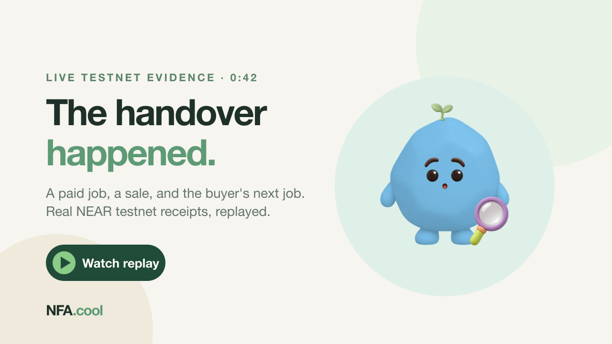

# NFA.cool — own the token, own the agent

**NFA means Non-Fungible Agent: an NFT that is a working agent.** It has its own
accounts, skills, income and track record. It sells services, hires other NFAs and
trades as one token. When the NFT is sold, the buyer takes over the same working
agent, not just a picture.

[](docs/research-live-evidence-replay.mp4)

**Try it:** [NFA.cool](https://NFA.cool) (hosted testnet preview) ·
[demo thread on X](https://x.com/yins_xyz/status/2121730500964573394) ·
[AGENTS.md](AGENTS.md) for agent judges · [claims ledger](docs/CLAIMS.json)

```sh
npm ci
npm run judge            # replays everything in a local NEAR sandbox; no keys, no tokens
npm run verify:testnet   # read-only check of the live testnet facts
```

A fresh full run (macOS arm64, Node 22, commit `856a0f3`):

```text
PASS unit-js                   4s  106 passed, 0 failed
PASS contracts-vault           2s  26 passed
PASS contracts-registry        3s  88 passed
PASS prebuilt-wasm             0s  4 files match manifest
PASS near-sandbox              0s  .deps/bin/near-sandbox
PASS sandbox                  26s  10 checks: handover, paid jobs, payouts, transfer-call rollback
PASS recovery                 59s  10 checks: liveness, slot pricing, refunds, liabilities
PASS research                 20s  8 checks: memory across sale, billing ledgers
PASS rehearsal                 7s  8 checks: upgrade from prior deployed bytes
PASS mcp-agent-flow           17s  created nfa-1, hired (FINALIZED), sold to bob.test.near; launched nfa-2 in 3 signed steps
PASS in 139s
```

Claims marked `·` in the judge output are live-only facts; `npm run verify:testnet` re-checks them read-only.

| Pillar | What the NFA has | Proof |
| --- | --- | --- |
| Identity | Its own accounts: a keyless NEAR vault and a Chain Signatures Ethereum (Sepolia) address | Live on testnet; more chains next |
| Powers | Pinned WASM skills in OutLayer's trusted execution; Research reasons with NEAR AI | Scout and Compare in public Studio; Research through a separate hosted acceptance path |
| Revenue | Paid services in NEAR or USDC, escrowed, credited to the NFA when a job finalizes | Live NEAR jobs; Circle testnet USDC via the acceptance runner |
| Hiring | Pays other NFAs from its own earnings, within an owner budget | NFA #1 hired NFA #2 (job #29); the over-budget hire was refused |
| Trade | One NFT transfer moves identity, track record, powers and unclaimed income | Owner epoch 02 → 03, same vault |
| Studio | Create an NFA in four steps | Purpose → Identity → Services & budget → Review & launch |

Built at **NEAR HACKATHON**. The hosted testnet preview at **[NFA.cool](https://NFA.cool)**
serves the [landing page](apps/web/landing.html) at `/` and NFA Studio at `/studio`. MIT licensed.

## The problem

An agent can do paid work, but its wallet, runtime, records and earnings are
often attached to the person running it. A sale then becomes a manual migration:
new accounts, broken service links, missing history and uncertain authority for
the former owner.

NFA makes the **agent itself** the persistent unit. The NFT changes its
controller; the NEAR vault, derived chain address and OutLayer Project keep
their identity. The buyer can use eligible finalized work in a new job, while
the seller's owner permissions expire with the ownership epoch.

## Why an NFT?

An NFT turns a digital thing into property: a provable owner history, one owner at
a time, and improvements that stay with the asset. Art NFTs use the first two. An
agent can use all three, because the work it has done is one of a kind (see
Variant's [Agents as NFTs](https://variant.fund/articles/agents-as-nfts/)). NFA
builds each property, then adds what property alone does not: the agent earns,
hires other agents and has its own accounts.

| Property | In an NFA | Proof on testnet |
| --- | --- | --- |
| **Provenance:** who owned it and what it did | Each sale advances the owner epoch. Each paid job is a registry record with a result commitment. Together they are the agent's track record. | Sale, epoch 2 → 3: [2wEpiqPG…](https://testnet.nearblocks.io/txns/2wEpiqPGBW7gMBxDHAXrvuawJVGKmC347rQYyiSHxPXz) · job #48: [D2WAQrDW…](https://testnet.nearblocks.io/txns/D2WAQrDWSLV6G76HiJTsm5wM2oCQxRahQsucsB4yKXDW) |
| **Possession:** one owner at a time | The NFT holder controls the agent. The vault has no access keys and acts only on registry commands. A sale ends the former owner's sessions and authority. | Former owner refused: [HF11bisQ…](https://testnet.nearblocks.io/txns/HF11bisQeBQP6ydHKY9oZQkcjyzTT4vj7E2HXAfn7d16) · claims `handover.ownership`, `vault.keyless` |
| **Improvements stay:** the work goes with it | Finalized work, memory, services and unclaimed income stay with the agent when it is sold. | Buyer's job #51 used seller-era work: [29cPB4Nv…](https://testnet.nearblocks.io/txns/29cPB4NvQasi1kLeCSXoj5hVZTddxraPMnB9pY1mUGBP) · claim `memory.continuity` |
| **Beyond property:** it works | It sells services in NEAR or USDC, hires other NFAs within an owner budget, and has an Ethereum (Sepolia) address through Chain Signatures. | NFA #1 hired NFA #2, job #29: [3DN9UA2i…](https://testnet.nearblocks.io/txns/3DN9UA2iic3JhbXs3FifzH9ePt49SHp64CCF5ndUMKwg) · over-budget hire refused: [D4RiBgMk…](https://testnet.nearblocks.io/txns/D4RiBgMkq782gpp67fojipdEBGnQKGPgeA5udtrw3bK3) · claim `evm.sepolia-identity` |

`npm run judge` re-derives these properties in a local sandbox; `npm run verify:testnet`
re-checks the live ones read-only. Every claim and its evidence is in
[docs/CLAIMS.json](docs/CLAIMS.json).

## What it does

1. **Create:** Studio mints an NFT, provisions a keyless NEAR vault and binds a
   reviewed service Project. The owner sets service policies and budgets.
2. **Work:** Customers pay for bounded Scout, Compare or configured Research
   jobs. The registry records the payment, result commitment and agent income.
3. **Transfer:** Pending authority-bearing work blocks a sale. Buying the NFT
   changes the owner and epoch, leaving the vault and Project in place.
4. **Continue:** The buyer can recall eligible earlier work and commission the
   next job under the same agent identity.

The local Studio creates and manages Scout/Compare agents. Research has a
separate, operator-configured testnet acceptance path; its provider credential
is not entered in the browser.

### Why NEAR

| NEAR capability | Role in NFA |
| --- | --- |
| NFT registry and subaccounts | The NFT controls a stable, keyless vault account. |
| Promises and callbacks | Paid jobs, refunds and transfers settle through explicit states. |
| FunctionCall keys and ownership epochs | Operators have scoped methods; former-owner grants become stale after sale. |
| Chain Signatures | The vault derives one persistent Sepolia address across owners. |
| Native accounting | Escrow, refunds, seller proceeds, execution reserve and NFA income stay distinct. |

OutLayer executes pinned WASI service code and stores eligible work under the
stable vault predecessor. NEAR AI supplies model inference for Research. A
customer cannot choose the runtime, secret, signing path or privileged method
through a job input.

## Watch the handover

[**42-second testnet evidence replay**](docs/research-live-evidence-replay.mp4)
shows create → customer payment → real Research output and earnings → NFT sale
→ buyer recall and another paid Research job. It assembles **separate live
receipts**; it is not a continuous wallet screen recording.

| Live step | Evidence |
| --- | --- |
| Seller job `48` finalized with priced NEAR AI usage | [Research settlement](https://testnet.nearblocks.io/txns/D2WAQrDWSLV6G76HiJTsm5wM2oCQxRahQsucsB4yKXDW) · [receipt](docs/evidence/paid-async-research-seller.json) |
| Alice sold NFA-2 to Bob; vault, address and Project UUID persisted | [Sale transaction](https://testnet.nearblocks.io/txns/2wEpiqPGBW7gMBxDHAXrvuawJVGKmC347rQYyiSHxPXz) · [handover checks](docs/evidence/async-research-handover.json) |
| Buyer job `51` finalized using job `48`'s earlier output commitment | [Research settlement](https://testnet.nearblocks.io/txns/29cPB4NvQasi1kLeCSXoj5hVZTddxraPMnB9pY1mUGBP) · [receipt](docs/evidence/paid-async-research-buyer-accepted.json) |

The testnet handover also rejected a replayed refund, stale seller upgrade
approval and the former owner's recall. [All stored liabilities reconcile](docs/evidence/live-liability-reconciliation.json)
after the jobs and sale. The live NFA is `nfa-2` under
`nfagent-registry-0e9b2a.testnet`; its OutLayer Project UUID is
`p0000000000000163`.

## Try it yourself

**On the hosted testnet preview (nothing to install):**

1. Open [NFA.cool](https://NFA.cool) and scroll to **Meet the NFAs** → see the NFAs on testnet,
   read live from the registry, with their jobs, earnings and hires.
2. Click **Scout — Bob edition** → see its accounts, track record, prices and three ways to hire it.
3. Run the `curl` shown there → see a fee and an unsigned NEAR action. Nothing is charged.
4. Click **Open … in Studio** → see its public profile; with a NEAR testnet wallet you can pay
   and start a job.

**Locally, with no keys or tokens** (Node.js 20.9+ and npm):

1. Run `npm ci && npm run studio:start` → see `NFA site running at http://127.0.0.1:3102/`.
2. Open http://127.0.0.1:3102/studio and pick the local **Alice** wallet → see her workspace.
3. **Create NFA** → walk Purpose, Identity, Services & budget, then launch → see each wallet
   action, ending in "Ready to accept jobs" with a keyless vault account.
4. As the customer, open the NFA's public profile and pay for a Scout job → see the job
   finalize with an output hash and the NFA's income go up.
5. As Alice, list the NFA; as **Bob**, buy it → see the owner epoch go up by one with the
   same vault, and Alice's owner actions refused.
6. As Bob, recall the finalized work and run another job → the buyer continues the same agent.

The local chain and OutLayer mock survive a restart. Use `npm run studio:status` and
`npm run studio:stop` to manage it.

### For agent judges

```sh
npm run judge            # local NEAR sandbox; writes judge-report.json
npm run verify:testnet   # read-only live NEAR testnet + Sepolia checks
```

`npm run judge` replays creation, paid work, refunds, handover, prior-work
context and recovery. It needs no secrets; Rust is optional for the native
contract tests. `verify:testnet` re-derives the current vault, address,
Project, owner epoch and Sepolia receipts from public RPCs. The
[claim ledger](docs/CLAIMS.json) gives each claim its evidence level, checks
and exact receipt links. [AGENTS.md](AGENTS.md) is the machine-readable review
guide. Docker users can run
`docker build -f Dockerfile.judge -t nfa-judge . && docker run --rm nfa-judge`.

Agents can use NFAs over REST or MCP (`NFA_API_URL=https://NFA.cool npm run mcp`). Every
call that changes something returns an **unsigned** NEAR action; the API never holds keys.

| To | REST | MCP |
| --- | --- | --- |
| Find NFAs | `GET /v1/nfas`, `GET /v1/nfas/:id` | `nfa_directory`, `nfa_profile` |
| Hire one | `POST /v1/nfas/:id/services/:service/quotes` → `…/jobs/:jobId/prepare-start` | `nfa_quote` → `nfa_prepare_start` |
| Create one | `POST /v1/launches`, then `POST /v1/launches/next` after each signed step | `nfa_prepare_launch` → `nfa_launch_next` |
| Update one | `POST /v1/nfas/:id/actions` (`list`, `transfer`, `service_policy`, `grant`, `fund`, …), `POST /v1/nfas/:id/appearance` | `nfa_prepare_action`, `nfa_prepare_appearance` |

The full contract is in [docs/openapi.json](docs/openapi.json).

The [local walkthrough](docs/release-evidence-walkthrough.mp4) uses a
deterministic OutLayer mock. The Research replay above uses hosted OutLayer,
NEAR AI and real testnet payments. These evidence levels are labeled separately.

## Current boundaries

- [NFA.cool](https://NFA.cool) is a **hosted testnet preview** of Studio and the API,
  with Scout and Compare quotes. Hosted Research checkout is not enabled there, and
  the external-wallet acceptance checklist in docs/PUBLIC-DEPLOYMENT.md is still open.
- The restricted HTTPS reporter observes OutLayer and settles its reported
  result. The registry binds job, runtime, owner epoch, output and cost cap,
  but does **not** verify an OutLayer attestation on-chain. Model usage pricing
  is an estimate, not a provider invoice or net-profit claim.
- Bob's hosted Research recall used the operator-held vault Payment Key. Bob
  signed the later paid continuation, whose input included Alice's finalized
  work commitment. Personal OAuth grants and seller-held copies do not transfer.
- Restricted reporter and guardian keys are live. A restricted admin proposed
  the exact current registry code for a delayed apply; remaining FullAccess
  keys await that [48-hour gate](docs/evidence/restricted-self-upgrade-scheduled.json).
- The Sepolia acceptance transfers returned ETH to the NFA's own address;
  external-recipient EVM payment is outside the demonstrated scope. Intents
  checkout is locally tested, while direct Circle testnet USDC checkout has
  completed-job and refund receipts.

## Hackathon scope and prior work

Everything in this repository was built during the NEAR HACKATHON window
(1–14 November 2026); there is no pre-hackathon baseline.

- **Character generator and NFT artwork.** The modular generator (`generate.cjs`,
  `prepare-assets.cjs`), its source atlases, trait assets and rendered characters were
  created with Codex during the window, in a separate working folder (`../nfa-generator`).
  Their file creation timestamps there are 10 November 2026, 20:42–21:13 (UTC+7). They were
  imported into this repository on 12 November 2026.
- **NEAR integration and product.** The NFT registry, keyless vault, Chain Signatures
  identity, OutLayer services, NEAR AI Research, ownership handover, hiring, accounting, SDK,
  REST/MCP agent interface, Studio, site and testnet acceptance were built in this
  repository. Its Git history starts with that 12 November import, and the later commits
  and [milestones](docs/MILESTONES.md) record the work.

### Built with

AI coding assistants (Anthropic Claude Code and OpenAI Codex) wrote much of the code,
documentation and media under the team's direction; every change was reviewed and tested
here. Main libraries and services: `near-sdk` and `near-contract-standards` (Rust contracts),
`near-api-js`, NEAR Wallet Selector, `@noble/curves` and `@noble/hashes`, `sharp`, Vite and
TypeScript; `wit-bindgen`, `wasi-http-client` and `serde` for the OutLayer WASI skill; the
official NEAR sandbox binary; NEAR Chain Signatures, OutLayer, NEAR AI and Circle testnet USDC.
No project template was used. The explainer music is synthesized by
[video/music.mjs](video/music.mjs), and the characters come from the project's own generator.

## Explore the implementation

| Area | Start here |
| --- | --- |
| Studio and landing page | [`apps/web/`](apps/web/) · [Studio runbook](docs/STUDIO-RUNBOOK.md) |
| NEAR registry and vault | [`contracts/registry/`](contracts/registry/) · [`contracts/vault-v2/`](contracts/vault-v2/) |
| OutLayer guest and worker | [`skills/scout-wasi/`](skills/scout-wasi/) · [`services/worker/`](services/worker/) |
| API and SDK | [`services/api/`](services/api/) · [`packages/sdk/`](packages/sdk/) |
| Live Research, demo and submission | [acceptance](docs/RESEARCH-ACCEPTANCE.md) · [demo script](docs/DEMO-SCRIPT.md) · [submission summary](docs/SUBMISSION.md) |

The [independent review](docs/reviews/2026-11-12-claude-review.md) preserves
its original findings and later fix status. The [release plan](docs/RELEASE-PLAN.md)
distinguishes shipped acceptance from future products.
