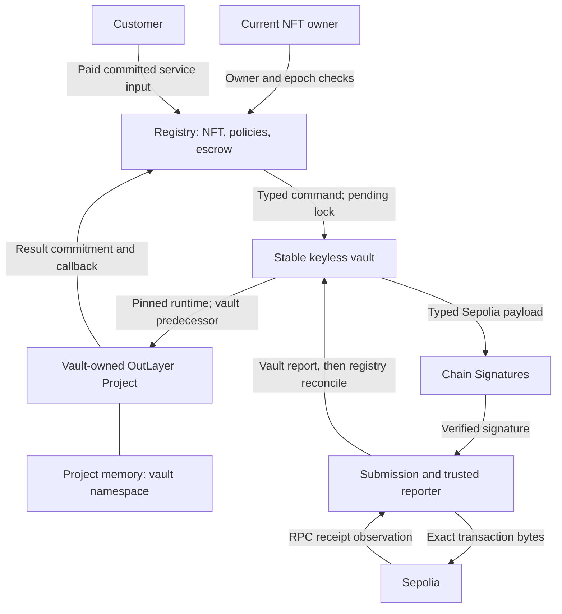

# NFA ownership and execution

The NFT controls a stable NEAR vault through registry methods. Its owner and
epoch change on sale; vault identity, pinned addresses and the vault-owned
OutLayer Project remain stable. Human-owned credentials are separate grants.

## What moves on sale

Control over the NFT's vault, approved service policies/runtime, eligible
finalized work and unclaimed NFA income follows the current NFT owner. The
same vault determines its pinned Chain Signatures address and stable OutLayer
caller namespace. A pending job, signature or payout blocks handover until
reconciliation. Prior owner sessions and grants do not survive the epoch.

## Boundaries

REST prepares unsigned actions. Wallets sign; the API does not impersonate the
owner. An HTTP token ID grants no authority. Work reads use NEP-413 and current
owner/epoch checks. Customer inputs cannot select project-management methods,
arbitrary signing payloads, endpoint credentials or a vault key.

The hosted runtime currently provides deterministic supplied-text Scout and
Compare. The retrieval/inference runner is a candidate outside that hosted
runtime. Its USD usage ledger must remain separate from customer NEAR escrow,
OutLayer execution replenishment and credited NFA earnings.

The reporter trusts RPC observations; NEAR does not verify Sepolia finality.
Guardian upgrades are another disclosed authority. OutLayer execution evidence
does not establish source truth, and full Intel collateral verification was not
independently completed. The seller can retain downloaded data. Third-party
subscriptions, OAuth and nontransferable credentials need their own consent or
reissue adapters.
