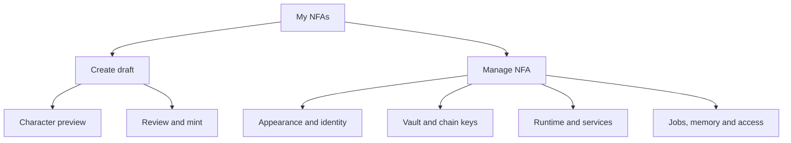

# NFA Studio — creation and management plan

Status: S001–S022 implemented and testnet acceptance passed, 2026-11-12. See the
[task status](NFA-STUDIO-STATUS.md) and [runbook](STUDIO-RUNBOOK.md) for evidence and startup.
The web app has a creator, owner workspace, passport, treasury actions and market.
This plan describes the complete workspace for one NFT, one persistent
vault and one OutLayer Project with reviewed services. Hosted OutLayer work is
tracked separately in [OUTLAYER-STATUS.md](OUTLAYER-STATUS.md).

## Product model

Studio has two modes: **Create** a new NFA, then **Manage** a token the connected
wallet currently owns. A saved draft is not an NFA. A minted token owns the
unchanged vault; changes to its appearance or service catalog update versioned
metadata and policy, not the token ID or vault address. The NFT can be sold with
the vault's balances, pinned chain-signature address, Project UUID, approved
runtime and finalized memory. A buyer gets current owner authority; old owner
sessions and grants stop working at the new ownership epoch.

| Studio area | Owner sees and changes | Chain or host of record |
| --- | --- | --- |
| Character | Traits, seed, previews, image and display name | Content-addressed image/manifest; registry manifest pointer |
| Identity | NFT, owner epoch, vault, provenance and activity | NEAR registry and vault views |
| Treasury | NEAR balance, reserved runway, earnings and withdrawals | Vault balance and registry ledgers |
| Chain keys | Pinned address, derivation policy, approved actions and limits | Vault + Chain Signatures signer; no exported private key |
| Runtime | One OutLayer Project UUID, active/candidate WASM hash and health | Vault/registry plus OutLayer Project views |
| Skills | Reviewed code capabilities and allowed tools | Audited runtime release and manifest |
| Services | Public input schema, availability, fee floor and resource caps | Registry `ServicePolicy`, API quote configuration |
| Memory | Finalized commitments, recall, artifact access and migration | OutLayer predecessor cell plus durable artifact store |
| Access | Delegates, expiry and reconnect-required connectors | Registry owner epoch; provider-specific grants |

The first release offers **Scout** and **Compare**. Scout extracts cited
findings from supplied text; Compare ranks supplied options by evidence
coverage. Neither fetches a URL or claims factual truth. Keep royalties,
Intents, x402, arbitrary third-party code, personal OAuth handoff and other
chains outside this Studio release.

The creation template is a preset, not a new contract type. A template selects
initial character locks, a proposed service catalog, resource caps and a
funding recommendation. The mint review makes every proposed policy explicit;
the owner can change it later. The public passport can show the character,
skills, services, vault identity and verifiable work without showing private
owner drafts or credentials.

## Screen map

The manage header always shows token ID, owner, owner epoch, vault, Project
status, pending lock and available NEAR. Each mutation has a review screen with
the exact signed action, expected cost, target account, current state and the
state expected after finality. On return from a wallet redirect, Studio reloads
chain state and reconciles the intent before offering another action.

The character editor uses a live layered preview and a trait tray grouped by
body, face, eyewear, attachment, tool and scene. Randomize only unlocked
traits. Save a seed and selected trait IDs, then show the exact published image
and manifest hashes at confirmation. The service editor has a catalog of
reviewed skills, a separate priced-service form, and a test pane with
simulated versus hosted results clearly labeled.

## Phase 1 — creator and character editor

1. **S001 — Build a Studio shell.** Add `/studio` with `My NFAs`, `Create`,
   `Manage` and a read-only public passport. Connect a NEAR testnet wallet;
   derive owner controls from finalized `nft_token`/`agent` views. **Pass:** a
   non-owner sees the passport but cannot prepare owner actions.
2. **S002 — Expose the full active art catalog.** Use `assets/catalog.json`,
   `generate.cjs` and `services/api/render.mjs` to offer body, palette,
   expression, tool, finish, marking, background, frame, eye-aligned eyewear
   and one compatible attachment/ornament/fitted hat. Keep retired universal
   headwear hidden. **Pass:** invalid head/body combinations cannot be saved;
   generated previews and metadata have the same hash as the CLI renderer.
3. **S003 — Save recoverable drafts.** Store seed, locked traits, display name,
   selected service template and creation request ID locally with an optional
   account-scoped server draft. No draft may contain keys, OAuth tokens or
   sensitive research. **Pass:** refresh and wallet redirect preserve the draft
   without accidentally minting twice.
4. **S004 — Publish immutable character artifacts.** Persist full PNG,
   transparent cutout, trait metadata, asset-catalog digest and manifest by
   content hash in durable storage. Return a stable URI; verify every read.
   The current preview cache key is insufficient as a permanent NFT image.
   **Pass:** a second API process reproduces the preview and image hash.
5. **S005 — Review and mint.** Show token creation deposit, immutable artifact
   hashes, initial vault balance, included template and future operating
   reserve. Submit `create_agent` with a stable request ID; reconcile the
   registry's `request_token` and provision callbacks before showing success.
   **Pass:** a timeout or rejected wallet action cannot create a duplicate NFA.
6. **S006 — Edit appearance after mint.** Owner previews a new image and
   manifest, then signs `update_manifest`. Keep immutable old versions and a
   visible revision history. Check owner epoch again just before publishing;
   do not alter the vault, Project UUID or past job receipts. **Pass:** Bob can
   edit after transfer, while Alice's old session/action fails.

## Phase 2 — vault and chain-signature console

7. **S007 — Add the vault dashboard.** Show total balance, storage reserve,
   pending operation, OutLayer daily deposit budget, estimated runway,
   customer escrow, replenishment liabilities, earned income and payout
   availability as separate numbers. **Pass:** Studio never labels locked
   funds as spendable or a submitted callback as final.
8. **S008 — Display the pinned chain-signature identity.** Integrate current
   `derive_wallet` and `derived_wallet` views for the existing Sepolia path.
   Derive once and pin the result; show signer, path, domain, chain ID and
   explorer address. **Pass:** the address remains identical after NFT sale.
9. **S009 — Define a chain-key registry before adding chains.** Extend the
   vault/registry with an explicit `(token, chain, derivation path, address,
   signer version)` record and one approved adapter per chain. Never accept a
   user-supplied arbitrary signing path or payload. **Pass:** cross-token and
   cross-chain requests cannot reuse an unintended key or signature domain.
10. **S010 — Add a transaction policy builder.** Let the owner choose only
    reviewed operations and set recipient allowlists, value/gas ceilings,
    delegate budget and expiry. Simulate and display the exact unsigned
    transaction/digest, pending lock and failure recovery. **Pass:** customer
    service input cannot reach project management, treasury methods or a
    project-bound signing key; ownership transfer invalidates old grants.
11. **S011 — Make recovery visible.** Show `REQUESTED`, `SUBMITTED`,
    `UNCERTAIN`, `RECONCILING` and terminal outcomes; provide the existing
    explicit reconciliation methods only in applicable states. **Pass:** no
    timeout becomes an automatic refund, retrigger or unlocked sale.

## Phase 3 — OutLayer runtime and service manager

12. **S012 — Create the Project panel.** Display the vault-owned `/scout`
    Project ID, UUID, active and candidate hashes, immutable URL, storage
    account binding and registry/vault/OutLayer agreement. Provision only from
    the current owner through the registry. **Pass:** an ambiguous create is
    reconciled by Project ID; Studio never offers a second create while the
    first is unresolved.
13. **S013 — Review runtime releases.** Upload immutable WASI P2 bytes,
    verify downloaded SHA-256 and manifest `storage_account: predecessor`,
    run Scout/Compare fixtures and a hosted staging job. Add a candidate
    version, inspect its diff, then activate it by owner action. Keep the UUID
    unchanged. **Pass:** old Scout memory can be recalled after activation.
14. **S014 — Separate skills from services.** A skill is reviewed runtime
    code/tool access; a service is a customer-facing priced entry point.
    Show runtime hash, input/output schema hash, allowed operation, memory
    namespace, tool permissions and provenance for each skill. New code needs
    a reviewed release, not a customer-provided URL. **Pass:** unknown service
    IDs and unapproved operations fail in API, registry and guest.
15. **S015 — Configure Scout and Compare.** Build owner forms for enable,
    schema hash, minimum margin, maximum deposit and resource limits using
    `configure_service`. Show the corresponding local API quote policy and
    its mismatch warning. **Pass:** direct callers cannot bypass the on-chain
    floor, and disabling a service does not rewrite an outstanding job.
16. **S016 — Add a service simulator.** Validate typed sample input, run the
    deterministic local handler, show output and estimated deposit, then
    optionally request a hosted staging run. Separate source text from source
    URL labels. **Pass:** a preview is marked simulated until a finalized
    OutLayer receipt and verified runtime hash exist.
17. **S017 — Add live job operations.** Show the customer quote, exact
    committed input hash, wallet payment, assigned job ID, start action,
    callback, refund/replenishment and final artifact. Use the registry ID
    returned by confirmed chain state. **Pass:** Scout and Compare execute
    under the same Project UUID with separate ledgers and no duplicate start.
18. **S018 — Manage memory and artifacts.** Show `pending` versus finalized
    commitments, service namespaces, owner recall, historical versions and
    access checks. Store full artifacts durably with hash verification; check
    current owner/epoch on every owner-only read. **Pass:** Bob can recall a
    finalized pre-sale job; Alice's old API session cannot read it. Public
    NEAR input and recall summaries remain explicitly labeled public.

## Phase 4 — lifecycle, handoff and release

19. **S019 — Show transferable inventory.** Summarize what the buyer receives:
    vault balance and liabilities, pinned chain addresses, Project UUID and
    versions, enabled service catalog, finalized work, manifest and current
    grants. Mark personal connectors as reconnect-required and warn that the
    seller may retain downloaded copies. **Pass:** preview is derived from
    current on-chain state immediately before listing or transfer.
20. **S020 — Make sale/transfer a reviewed handoff.** Disable listing while
    operations are pending; show owner epoch change and approvals that will
    clear. Reconcile the actual NFT transfer/buy receipt before switching the
    workspace to Bob. **Pass:** Bob's service and vault controls work, Alice's
    owner actions fail, and the vault/Project identifiers stay unchanged.
21. **S021 — Add an audit timeline.** Correlate manifest revisions, service
    policies, runtime hashes, Project changes, jobs, income, signatures,
    recalls and transfers with transaction IDs and explicit uncertainty.
    **Pass:** an operator can trace a service result to an immutable WASM,
    input hash, OutLayer callback and NFA ledger entry.
22. **S022 — Ship the end-to-end Studio demo.** On a funded disposable
    testnet NFA: create character → mint → provision Project → enable Scout
    and Compare → run both paid jobs → recall → list/sell → buyer edits
    character and recalls old work. Include failure, pending-lock and
    version-upgrade demonstrations. **Pass:** another developer can replay
    the flow from recorded contracts, hashes, transactions and setup steps.

## Data contracts and implementation order

Use a versioned manifest with `publicCharacter` (seed, traits, renderer
version, asset digest, image/cutout hashes), `identity`, `skills`, `services`,
`access` and a previous-manifest hash. The registry stores a content hash and
URI; mutable owner policy stays in contract state. Rendered image storage is
separate from OutLayer encrypted memory. Keep server drafts disposable,
published artifacts immutable, and sensitive connector credentials out of
both public manifests and on-chain job inputs.

The critical path is `S001–S006 → S007–S011 → S012–S018 → S019–S022`.
S012–S018 depend on the hosted gates in
[OUTLAYER-COMPLETION.md](OUTLAYER-COMPLETION.md); character editing and the
read-only vault console can be developed locally while those gates run.
The current fixed Sepolia path is the initial chain-key example. S009 is a
separate protocol change, not a Studio-only toggle.

## API and wallet boundaries

| Action | Studio request | Authority and finality |
| --- | --- | --- |
| Preview character | Existing `POST /preview`, trait IDs and seed | Public deterministic render; no wallet action |
| Save draft | Proposed `PUT /studio/drafts/:id` | Owner-scoped server or local storage; never a minted token |
| Publish artwork | Extend existing `POST /manifests` and `/preview/:hash.png` with durable artifact storage | Server verifies content hashes and returns immutable URI |
| Mint or change appearance | Wallet signs `create_agent` or `update_manifest` | Registry confirms owner/request ID and resulting manifest |
| Inspect chain identity | Read `derive_wallet`, `derived_wallet`, vault and policy views | Only reviewed vault method signs an approved transaction |
| Set skill/runtime | Upload verified WASM, then owner signs version/policy action | Candidate stays inactive until hosted probe and hash check pass |
| Set service price | Owner signs `configure_service`; API mirrors policy | On-chain floor and limits remain authoritative |
| Run service | Existing quote, payment, start and status endpoints | Customer pays registry; vault calls OutLayer; receipt reconciled |
| Recall work | Owner-signed registry/vault recall | OutLayer storage cell is bound to the stable vault predecessor |

The testnet acceptance uses `nfa-2` and vault-owned UUID
`p0000000000000163`. Scout/Compare, sale, buyer edit/recall, runtime-version
continuity, definite failure/refund and pending lock passed. The original probe
failure and subsequent successful runs remain documented in
[OUTLAYER-TESTNET-EVIDENCE.md](OUTLAYER-TESTNET-EVIDENCE.md). Production API hosting
and external bucket configuration are separate deployment work.
