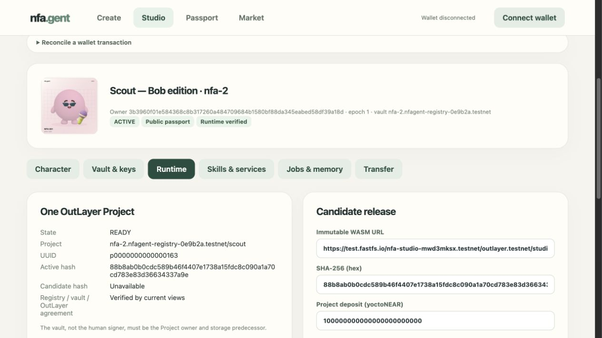

# NFA Studio implementation status

Updated 2026-11-12. The [six-point product flow](STUDIO-UX-STATUS.md) adds compact creation, persistent state and public service profiles. **S001–S022 are implemented and the testnet acceptance
sequence passed.** The API/UI runs locally; public web hosting and a production
object bucket are deployment choices, not already provisioned services.
Start with [STUDIO-RUNBOOK.md](STUDIO-RUNBOOK.md).

| Tasks | Completed behavior | Evidence |
| --- | --- | --- |
| S001–S003 | Studio shell, current-owner controls, full compatible trait catalog, locks, previews, recoverable drafts | Browser flow; generator and UI tests |
| S004 | Content-addressed PNG/cutout/manifests; private S3-compatible backend; hash verification; public FastFS reads without API cache | AWS CLI HTTP integration test, tamper/failure tests; live empty-cache check |
| S005–S006 | Reviewed mint with stable request recovery; buyer appearance revisions and immutable history | Testnet `nfa-2` mint and Bob edit; local browser mint and revision |
| S007–S009 | Separate balances/liabilities, daily deposit budget, locked reserve and income; explicit pinned Sepolia key record | Live derivation; identical address after sale; typed signing fixtures |
| S010–S011 | Owner/delegate recipient and value policies, exact NEAR/EIP-1559 preview, state-specific recovery | Native policies/epoch tests; real guest failure, vault-clear recovery and refund withdrawal |
| S012–S013 | One vault-owned Project; registry/vault/host agreement; immutable byte verification and gated version activation | UUID `p0000000000000163` unchanged; V1 memory recalled under V2 |
| S014–S016 | Reviewed skills with schemas/tools/namespaces; separate Scout/Compare pricing; local typed simulation and cost estimate | Native/JS parity fixtures, hosted Scout and Compare |
| S017–S018 | Quote/pay/assigned-ID/start/status; current-owner NEP-413 artifact access; deterministic full-artifact reconstruction | Finalized jobs 2, 3 and 11; Bob recall; Alice session denied |
| S019–S020 | Current transfer inventory, listing/cancel/buy/transfer review and pending lock | Alice lists, Bob buys; old owner denied; listing during pending job denied |
| S021 | Paginated on-chain audit plus verified wallet transaction journal | Final receipt inspection binds signer, token, receiver, input and assigned job ID |
| S022 | Create → mint → provision → two paid services → recall → sale → buyer edit/recall; failure and runtime change | [Testnet evidence](OUTLAYER-TESTNET-EVIDENCE.md), screenshot and JSON records |

Final checks: **65 JavaScript tests, 14 vault tests, 36 registry tests**, web/SDK
builds, full OutLayer-mock NEAR sandbox receipt suite and actual-old-bytecode
upgrade rehearsal. The latest registry bytes were deployed on testnet only
after that exact-byte rehearsal. A separate hosted test rejected stale runtime
and service-policy quotes without allocating a job, then finalized a valid one.

## Current testnet identity

- Registry: `nfagent-registry-0e9b2a.testnet`
- NFT: `nfa-2`; vault: `nfa-2.nfagent-registry-0e9b2a.testnet`
- Project: `nfa-2.nfagent-registry-0e9b2a.testnet/scout`
- UUID: `p0000000000000163`
- Active runtime: `88b8ab0b0cdc589b46f4407e1738a15fdc8c090a1a70cd783e83d36634337a9e`
- Registry SHA-256: `99fd106f60d79b4b4fa289fee9c2630b0412fd25ddb849ab04243344c1bb0636`

The V2 change is release metadata only; executable logic is unchanged. It proves
that a different pinned runtime version can retain the same Project storage.
Five hosted task quotes were captured; their report-data hashes and chain/input/
runtime bindings match. Intel collateral and certificate-chain verification was
not independently performed. Attestation does not establish factual accuracy.

## Deployment and scope limits

The real demo's artwork is published to FastFS. New API-created artwork/work is
local until `NFA_S3_*` is configured or a durable data mount is provided. The S3
adapter passed a real AWS CLI request/restore test against a local S3 boundary;
no production bucket or public API host was created. MyNearWallet's external
redirect signing was not automated; equivalent browser flows used a strictly
loopback sandbox wallet, while the actual testnet sequence used signed scripts.

One NFA has one in-flight vault operation. Scout and Compare process supplied
public text; they are not an LLM service or an always-running agent. NEAR input
arguments and recall summaries are public. Services share the reviewed runtime's
trust boundary. Royalties, Intents/1Click, x402 settlement, personal OAuth handoff
and additional chains remain separate products. The Sepolia adapter still uses
a trusted settlement reporter; this release does not claim a new EVM settlement
end-to-end run. Existing old vault bytecode is not silently upgraded by updating
the registry; `nfa-2` was freshly provisioned with this release's vault.

